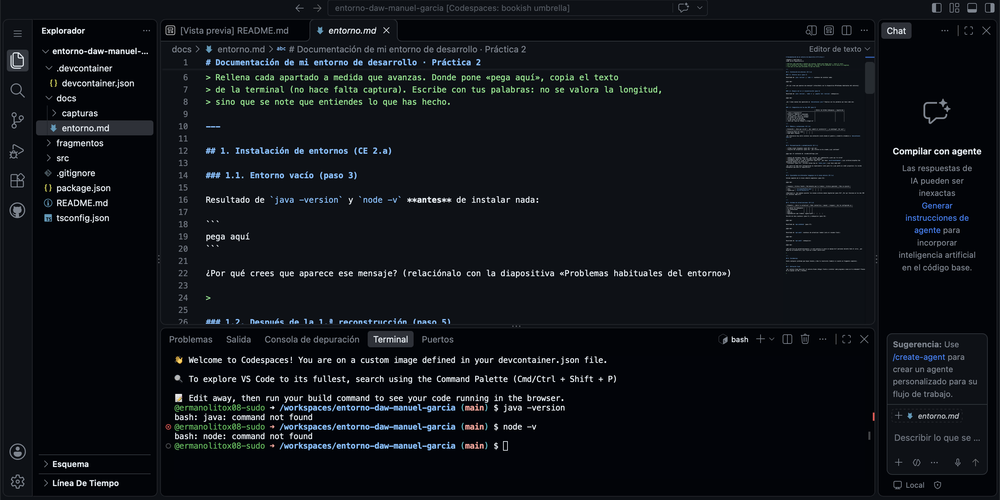

# Documentación de mi entorno de desarrollo · Práctica 2

**Nombre y apellidos:**
**URL de mi repositorio:**

> Rellena cada apartado a medida que avanzas. Donde pone «pega aquí», copia el texto
> de la terminal (no hace falta captura). Escribe con tus palabras: no se valora la longitud,
> sino que se note que entiendes lo que has hecho.

---

## 1. Instalación de entornos (CE 2.a)

### 1.1. Entorno vacío (paso 3)

Resultado de `java -version` y `node -v` **antes** de instalar nada:

```
bash: java: command not found
bash: node: command not found
```

¿Por qué crees que aparece ese mensaje? (relaciónalo con la diapositiva «Problemas habituales del entorno»)

> Aparece porque Java y Node.js todavía no están instalados en nuestro entorno de desarrollo, por lo que la terminal no reconoce sus comandos.

### 1.2. Después de la 1.ª reconstrucción (paso 5)

Resultado de `java -version`, `node -v` y `jupyter lab --version` **después**:

```
openjdk version "27" 2026-09-15
OpenJDK Runtime Environment Temurin-27+35 (build 27+35)
OpenJDK 64-Bit Server VM Temurin-27+35 (build 27+35, mixed mode, sharing)

v24.22.1

4.6.4
```

¿Qué líneas nuevas han aparecido en `devcontainer.json`? Explica con tus palabras qué hace cada una:

> Han aparecido las líneas `features`, `java:1`, `node:1` y `python:1`.

- `features`: permite añadir herramientas al entorno.
- `java:1`: instala Java para poder ejecutar programas Java.
- `node:1`: instala Node.js para trabajar con JavaScript y TypeScript.
- `python:1`: instala Python y, con `installJupyterlab: true`, también instala JupyterLab.

### 1.3. Comparativa de los dos IDE (paso 6)

| | Editor de GitHub Codespaces | JupyterLab |
|---|---|---|
| ¿Libre o propietario? | Propietario | Libre y de código abierto |
| Licencia / empresa o comunidad | GitHub, propiedad de Microsoft | Licencia BSD-3-Clause. Lo mantiene Project Jupyter y su comunidad |
| ¿Tiene coste? ¿Con qué límites? | Gratis hasta 120 horas de núcleo y 15 GB-mes en GitHub Free. Con 2 núcleos son 60 horas de uso al mes | Gratuito, sin límite de uso propio |
| ¿Se puede usar fuera de GitHub? | Se accede desde GitHub y se puede conectar con VS Code | Sí, se puede instalar en un ordenador |
| Lo que más me ha gustado | Poder programar desde el navegador sin instalar nada | Poder abrir archivos y usar la terminal fácilmente |
| Lo que menos me ha gustado | Tarda un poco en preparar el entorno | Me costó conectarme al servidor al principio |
| ¿Para qué tipo de trabajo lo elegiría? | Para proyectos de programación en equipo | Para trabajar con Python y cuadernos de datos |

---

## 2. Módulos y extensiones (CE 2.b)

| Extensión | ¿Para qué sirve? | ¿Qué cambió al instalarla? | ¿La mantengo? ¿Por qué? |
|-----------|------------------|----------------------------|-------------------------|
| Extension Pack for Java |   |   |   |
| Code Spell Checker      |   |   |   |

¿Qué diferencia hay entre instalar una extensión **solo desde el panel** y añadirla **también a `devcontainer.json`**?

> 

---

## 3. Personalización y automatización (CE 2.c)

- **Tema visual elegido** (paso 10) y por qué:
- **Ajuste del proyecto** (paso 10). ¿Qué archivo se ha creado y qué contiene?

```
pega aquí el contenido de .vscode/settings.json
```

- **Atajo de teclado** (paso 11). ¿Qué acción, qué combinación y para qué te sirve?
- **Snippet** (paso 12). ¿Qué escribes y qué aparece?
- **Automatización al crear el entorno** (paso 14). ¿Qué hace `postCreateCommand` y qué archivos/carpetas han aparecido después de reconstruir?
- **Tareas** (paso 13). ¿Cuántas tareas hay en `tasks.json` y qué hace cada una?

¿Qué parte de toda esta configuración es **personal** (solo para ti) y qué parte es **del proyecto** (la recibe cualquiera que abra el repositorio)?

> 

---

## 4. Ejecutables de diferentes lenguajes en el mismo entorno (CE 2.e)

Salida completa de la tarea **Build completo** (paso 15):

```
pega aquí
```

| Lenguaje | Archivo fuente | Herramienta que lo traduce | Archivo generado | Cómo se ejecuta |
|----------|----------------|----------------------------|------------------|-----------------|
| Java       | `src/java/Factura.java` |   |   |   |
| TypeScript | `src/ts/factura.ts`     |   |   |   |

**Opcional:** ¿has podido ejecutar los mismos archivos desde JupyterLab (paso 19)? ¿Por qué funciona en los dos IDE sin instalar nada más?

> 

---

## 5. Sistema de actualizaciones (CE 2.d)

| Elemento | ¿Quién lo actualiza? | Modo (automático / manual / ninguno) | Qué he configurado yo |
|----------|----------------------|--------------------------------------|-----------------------|
| El editor de Codespaces |   |   |   |
| Las extensiones         |   |   |   |
| Java                    |   |   |   |
| Node.js                 |   |   |   |
| Dependencias npm (lodash, typescript…) |   |   |   |

Versión de Java **antes** (paso 5) y **después** (paso 18):

```
pega aquí
```

Resultado de `npm outdated` (paso 17):

```
pega aquí
```

Resultado de `npm audit` **antes** de actualizar lodash (solo el resumen final):

```
pega aquí
```

Resultado de `npm audit` **después**:

```
pega aquí
```

**Mi política de actualizaciones**: si este entorno lo usara un equipo de 5 personas durante todo el curso, ¿qué dejarías en automático y qué fijarías a mano? Justifícalo.

> 

---

## 6. Incidencias

Anota cualquier problema que hayas tenido y cómo lo resolviste (también si usaste un fragmento completo).

> 

## 7. Reflexión final

¿Qué ventaja tiene describir el entorno «como código» frente a instalar cada programa a mano en tu ordenador? Piensa en un equipo con Mac y Windows.

> 
